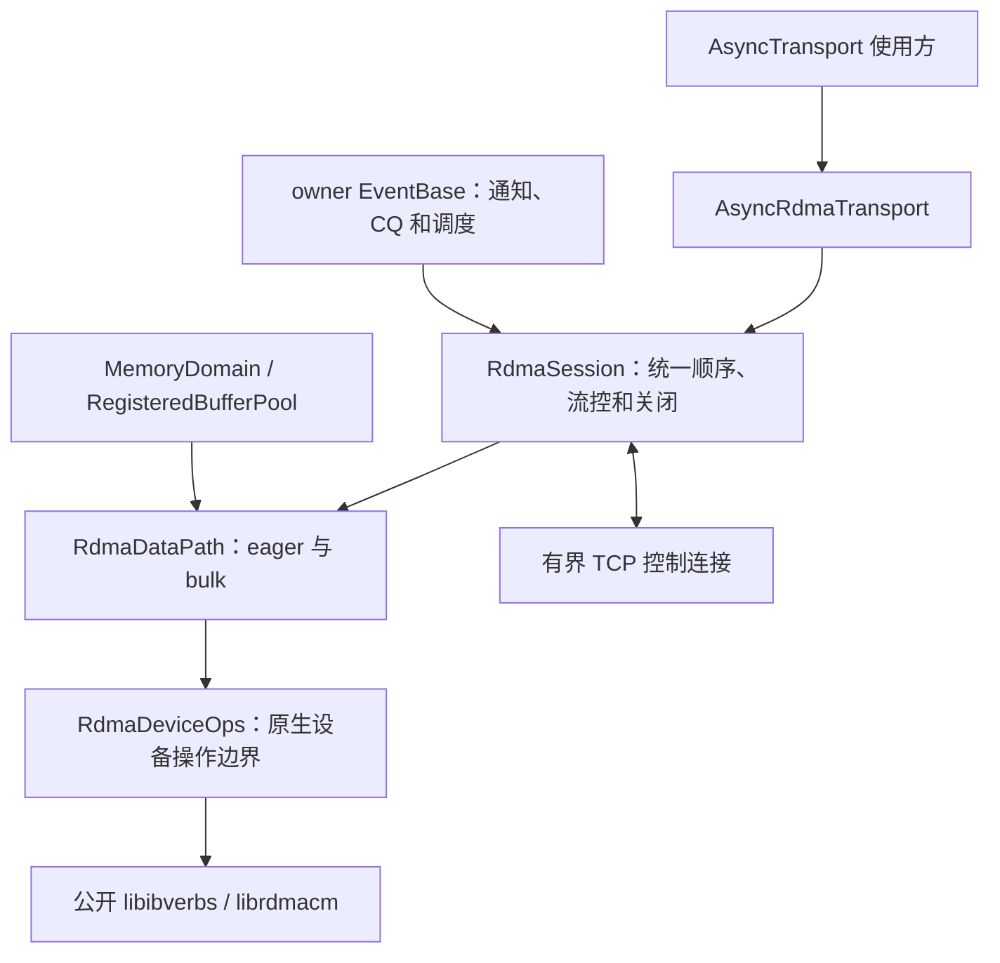

# Folly 完整 RDMA transport 后端合入提案

日期：2026-11-17。状态：供本项目审阅的上游范围提案，尚未向社区发布，尚未获得维护者接纳意见。

评审基线：Folly `f416c5d1cac01f8f3a59bce209a9ebb877da7307`。文中的类型名和模块划分是拟议设计，不代表上游已有 API。当前 RDMA 工作只有软件设计；尚未实现后端、搭建测试环境或取得构建、运行及性能结果。

配套材料：[上游沟通与阶段推进计划](AsyncRdmaTransportUpstreamPlan.zh.md)。

## 1. 本次希望先得到的决定

我们希望首先确认：**Folly 是否原则上愿意接收并在仓库内维护一个完整的、可选启用的通用 RDMA 字节流后端？如果愿意，接受范围、组件归属、review 和验证条件是什么？**

这里的“完整后端”指 `AsyncTransport` 适配、连接与会话、eager/bulk 数据路径、流控、注册内存和安全回收等核心实现，以及构建、文档和必要测试均在 Folly 中维护。底层依赖公开的 rdma-core、provider 和内核驱动；核心实现不留在另一个未公开组件中。

如果 Folly 更倾向独立库或仅接收通用扩展点，希望能明确说明。我们将把这记录为另一种接收范围；它不等同于本提案请求的完整后端合入。

本次请求范围与方向评审，不请求立即合并代码。通用 hook、小修复或 fbthrift 示例获接纳，也不视为完整后端已获批准。

## 2. 使用场景与进入 Folly 的理由

目标使用方是需要可靠、有序、双向异步字节流的 `AsyncTransport` 消费方。fbthrift/Rocket 是首个计划集成验证的使用方，不是 RDMA 核心的依赖。

计划解决三个问题：

1. 让既有异步字节流使用方接入 RDMA，而不把 QP、MR、rkey、slot 或 RDMA chunk 暴露给 RPC framing。
2. 让小消息 eager SEND/RECV 和大消息 bulk WRITE 共用一套顺序、资源预算、错误与关闭契约。
3. 将注册内存、IOBuf 所有权和异步硬件访问的寿命纳入 transport 契约，避免各个上层重复实现。

进入 Folly 的潜在价值，是让这一实现随 `AsyncTransport`、`EventBase` 和 `IOBuf` 的接口及测试共同演进，并服务于多个使用方。我们仍需证明实际复用需求和维护资源；仅继承 `AsyncTransport`，不足以证明代码必须进入 Folly。

独立库仍是本项目自主交付的路径，不依赖上游审核完成。我们不会把独立库已经可用当作 Folly 必须整体接收的理由。

## 3. 请求接收的完整范围

| 范围 | 拟纳入 Folly 的责任 |
| --- | --- |
| `AsyncRdmaTransport` | 读写、回调、超时、地址及统计等 `AsyncTransport` 行为适配 |
| 连接入口与 `RdmaSession` | 异步建连、能力协商、会话状态、有序字节流、关闭和错误协调 |
| `RdmaDataPath` | eager SEND/RECV、预授权 bulk WRITE_WITH_IMM、partial post、完成分发和硬件退休 |
| `MemoryDomain` 与注册池 | PD/MR、预注册 slab 子分配、配额、IOBuf 引用、后台注册及安全回收 |
| EventBase 集成 | completion channel/CM/设备事件驱动、有界 CQ drain、公平调度与继续推进 |
| 工程支持 | 可选依赖与构建、无硬件测试、原生验证入口、文档和明确支持矩阵 |

完整核心进入仓库不意味着全部模块成为公共 API。连接/配置入口和必要的 opt-in buffer 能力需要单独评审；Session、DataPath、DeviceOps 等原则上保持内部实现边界。

首期目标平台是 Linux。具体 CPU 架构、NIC/provider、驱动、固件和 rdma-core 版本组合，必须在真实验证后逐项列入支持矩阵，当前没有已验证组合。

以下内容在本次完整后端范围之外：

- 新的内核驱动、libibverbs provider、RDMA fabric 或拥塞控制协议。
- 公共单边 RMA API、GPU memory、collective、SRQ/QP 多路复用和活动连接跨 EventBase 迁移。
- CXL/ubmem 后端；它们需要独立的范围和设备语义评审。
- 修改 Thrift IDL、序列化或 Rocket framing，以及传输层透明重试已经接纳的 RPC 字节。
- 未经确认就要求 Folly 依赖 ZCRDMA 或 `thrift_fb/bulk_transport` 等未公开实现。

## 4. 拟议架构与对现有代码的影响

当前设计基线是每连接、每端一个 RC QP；每 `(owner EventBase, ibv_context)` 共享收发 CQ 与 completion channel；PD/MR 属于显式 MemoryDomain。该拓扑仍需容量及故障范围验证，不是性能推荐值。

控制面通过独立、有界的 TCP 连接交换版本、会话关联、额度、授权和关闭信息，不承载业务 payload。控制面必须在应用暂停读或 DATA 资源耗尽时继续推进；连接数量、CPU 和内存成本都计入后续评估。

首先使用现有 EventBase 事件和循环调度入口。修改 `EventBase`、通知队列或现有 socket 路径，必须有单独、可独立评审的必要性说明；本提案不把现有项目的 `ManualPoll` 改动作为捆绑前提。

公共基类的签名和现有语义保持不变。上游适配跟随评审基线的编译器和语言要求，不要求上游回退语言版本；本地旧基线的 C++17 兼容是独立工程约束。

## 5. 传输与内存契约

### 5.1 字节流与混合路径

- 每方向一个 payload offset 空间，一个 Session 和 WriteOp 顺序；RDMA chunk 和 `writeChain()` 调用均不等于 RPC frame。
- eager 与 bulk 共用接收字节窗口、累计 RQ credit 和接收内存预算。WRITE_WITH_IMM 通知同样消耗 RQ WQE。
- 常规 bulk 使用预注册、预授权的有界 slot window；不要求逐 chunk 请求远端内存，不串行等待上一条 lease 归还。rendezvous 只保留为按需冷路径。
- partial post 按实际接纳前缀记账，只回滚未提交后缀；已经部分提交的范围不透明改用另一条路径重发。
- 本地 post、本地 completion、远端发布、应用交付和 lease 归还是不同事件，分别计量。

### 5.2 回调、暂停和关闭

- 单连接状态和用户 callback 由固定 owner EventBase 串行执行；公开 transport 本身不提供任意线程并发调用保证。
- 每笔 write 恰好一次成功或错误终结，`writeStarting()` 最多一次；回调允许重入，返回后重新检查状态。
- 成功写回调表示调用方源数据已可安全释放或复用，不表示远端 RPC 或业务完成。错误字节数只报告已确认成功的连续前缀。
- 暂停读仅暂停上层交付，控制与 CQ 推进继续运行，所有积压受预算约束。
- 超时覆盖等待内存、额度、授权和数据进展；普通心跳不能掩盖写侧停滞。
- 逻辑关闭与硬件安全退休分开。立即关闭时按接口结束 callback，同时保留仍可能被 DMA 访问的 owned buffer、MR pin 和原生依赖；借用的调用方内存不得在回调后继续被访问。

### 5.3 注册内存与安全边界

- 预注册 slab 后子分配；可能阻塞的注册、注销和补货不在 owner EventBase 快路径同步执行。
- 普通或借用 buffer 使用注册 staging；只有本池管理、可可靠保活且权限匹配的 IOBuf 才规划直接 SGE。首期接收使用复制基线，不宣称端到端零拷贝。
- 注册池、退休和隔离中的内存均占用有界预算。无法证明原生访问退出或注销失败时保留隔离资源，停止超额准入，不提前复用。
- 当前 bulk 设计采用可信对端模型。共享 MR 的 rkey 可能覆盖多个 slot，软件 token 校验不能防止恶意越界 DMA；不宣称已有逐 lease 的硬件隔离或端到端加密。

## 6. 希望维护者重点评审的未决问题

| 问题 | 当前基线与需要的决定 |
| --- | --- |
| 代码归属 | 是否接受第 3 节完整范围；目录、公开 API 面和组件负责人由维护者确认 |
| 半关闭 | 当前细案对 `shutdownWriteNow()` 使用全连接立即关闭；需逐项核对 `AsyncTransport` 契约并确认能否接受，不能宣称与 socket 完全等价 |
| owner 与 detach | 活动连接首期不迁移；空闲 detach/attach 的可支持条件及 `isDetachable()` 行为在实现前明确 |
| provider 安全退出 | 需要为目标 provider 建立 QP/远端授权/在途访问退出与 MR 释放的具体保证和测试；抽象的 retire 接口不能替代证明 |
| 部署安全 | 会话认证、peer 关联、rkey 暴露边界和可信域条件须明确；不可信对端或逐 slot 隔离需要新的设计评审 |
| 支持矩阵与 CI | 普通 runner 能运行哪些测试；硬件由谁提供、如何报告回归、多久运行，当前尚未落实 |
| 维护资源 | 贡献方维护人员、可持续投入及上游 reviewer 均未确认；本稿不作无期限维护承诺 |
| fbthrift 适配 | socket 专属 timeout/egress 假设、每笔 write context/raw offset、接纳和停服路径，分别在 fbthrift 评审 |

## 7. 分阶段交付与证据要求

分阶段是为了可评审和可验证；本提案的最终范围始终包括 eager 与 bulk 的统一实现。

| 阶段 | 交付物 | 进入下一阶段前的证据 |
| --- | --- | --- |
| 范围评审 | 合入范围、目录、接口面、review 与验证条件的公开记录 | 相关维护者对完整范围给出实质意见；接受 hooks 不替代此项 |
| 共同契约与 eager | Session、资源账本、设备边界、基础 MemoryDomain/注册 staging 及 SEND/RECV 的可验证实现 | 字节顺序、背压、callback、关闭与退休的确定性测试；相应原生功能验证 |
| 预授权 bulk | WRITE_WITH_IMM 与 eager 共用账本、错误及回收机制 | 混合路径、partial post、陈旧授权、额度耗尽、双向关闭和错误退休测试 |
| 内存与使用方集成 | managed registered IOBuf 路径、资源计量和独立 fbthrift 适配 | 生命周期测试，真实 Rocket parser/codec 集成与逐项功能验收 |
| 支持与发布评审 | 固定平台矩阵、可复现记录、维护安排 | 真实 provider 验证；性能单独报告，不由模型结果推导 |

无硬件测试替换设备操作边界，复用生产 Session/流控逻辑；必须表达延迟 DMA、有限资源、partial post、一次性 CQ 通知和失败退出，不能让 fake 在 post 时立即完成一切。

原生和硬件验证另行检查 QP/CQ/MR、arm/get/ack、provider 退出及资源极限。性能比较保留负载方法、完成吞吐、尾延迟、总 CPU、NUMA、注册内存与控制连接成本；不预设提升比例。

构建应支持可选启用。禁用后端或缺少 rdma-core 时，既有 Folly 构建和用户路径继续可用；启用却缺少必需依赖时给出明确配置结果，不静默切换成模拟实现。

## 8. 本项目拟提供的贡献与待确认条件

本项目拟负责公开实现、文档、可复现的软件测试和 review 修改，并分别提交 Folly 与 fbthrift 的改动。具体人员、持续维护周期及硬件测试资源，在对外作承诺前落实并补充到提案。

我们希望维护者明确以下反馈：

1. 原则上接受完整核心、仅接受 adaptor/hooks，还是建议完全独立维护？
2. 如果接受完整核心，推荐目录、公开 API 范围及第一批实现边界是什么？
3. 哪位相关维护者愿意 review，哪些依赖、平台、测试和维护条件是必需的？
4. 第 6 节哪些设计差异必须先修改，哪些可在实验阶段逐步验证？

如果没有具体承接人和范围意见，独立交付继续推进；不会把缺少回复解释为批准，也不会把未合入解释为功能已被否定。

## 9. 参考资料与证据边界

- [Folly 贡献要求](https://github.com/meta/folly/blob/f416c5d1cac01f8f3a59bce209a9ebb877da7307/CONTRIBUTING.md)：测试、API 文档和 CLA 等常规要求；不提供新后端接收承诺。
- [AsyncTransport 契约](https://github.com/meta/folly/blob/f416c5d1cac01f8f3a59bce209a9ebb877da7307/folly/io/async/AsyncTransport.h)：实际兼容性评审的基准。
- [引入 AsyncIoUringSocket](https://github.com/meta/folly/commit/906cb6b377e036e51f433a9d139566ce9c63ec2b)：说明 Folly 曾新增 transport 实现；该实现仍使用 TCP，不能证明外部 RDMA 完整合入已有先例。
- [mvfst 的 QuicStreamAsyncTransport](https://github.com/meta/mvfst/blob/main/quic/api/QuicStreamAsyncTransport.h)：说明兼容 AsyncTransport 的实现可以长期位于外部库。
- [fbthrift 的 Rocket 接入](https://github.com/meta/fbthrift/blob/cd03aedb80318d5e33985d49a6a8999e92f6bac9/thrift/lib/cpp2/async/RocketClientChannel.cpp)：客户端入口不等于服务端和全部 Rocket 功能已兼容。
- [fbthrift 的 bulk response 接口提交](https://github.com/meta/fbthrift/commit/1040e0bbe011ca79f2d38e63cbfafa76c163f8d2)：仅作公共扩展边界的背景，不是本后端依赖、可复用实现或运行证据。

本次没有找到可确认的“外部团队孵化完整 RDMA 后端后整体进入 Folly”的同类先例。当前请求因此是范围与承接意愿评审，不以已有合入通道为前提。
